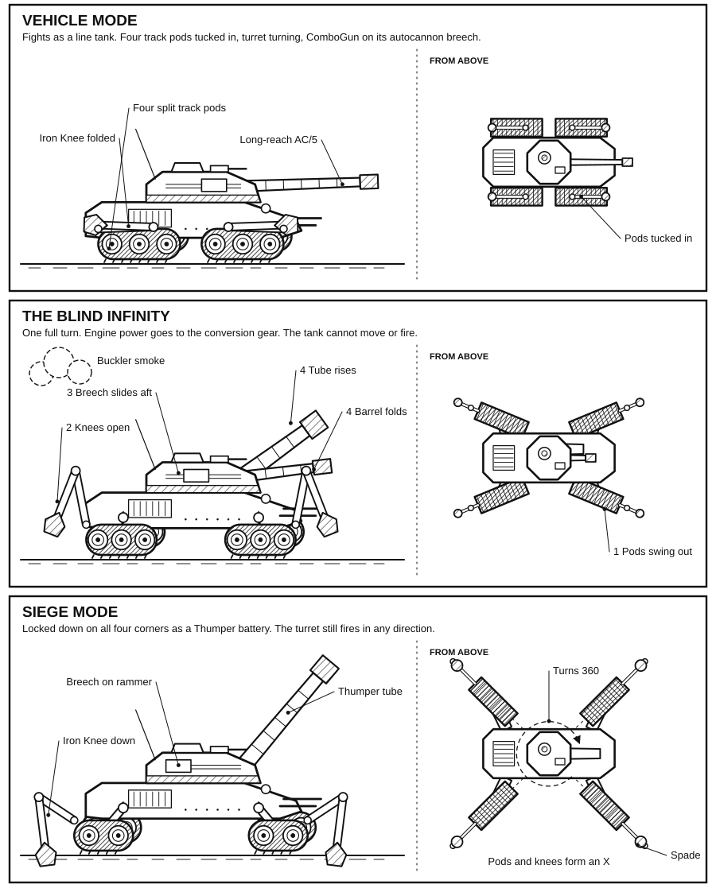

# Technical Readout: Combat Vehicle Overhaul (3085)

Custom Homebrew (rules level 6), not canon. ArtVee concept by kris (helvedes heste). Stat blocks are taken from the
app's nine sample designs; each one adds up to its tonnage.

## Introduction

Ask any gunner what kills gunners and you will hear one word: radar. A big gun fires, enemy radar finds it, and the
return shells come down on the spot where the battery stood. For centuries the only cure was to shoot and run. The Star
League trusted huge tracked guns like the Marksman, or fixed gun sites, and its crews fired and hoped they could move in
time.

The Artillery Vehicle, or ArtVee, ended that race. It kept up with heavy tank columns and fought at the front as a
direct-fire tank. Then, in a single ten-second turn, it locked down as a siege gun. The SLDF Quartermaster Command had
never owned anything so flexible. One unit could pin an enemy ridge under autocannon fire, switch to high-angle shells,
and smash forts miles away. It asked for no separate transport train.

The Inner Sphere lost the type by 2865. The Clans kept it. It came home in 3071 as the Mobile Artillery Platform, or MAP,
and it came home by a road no one in this Bureau would have guessed. This readout covers all nine patterns: three from
the Star League, three from the Clans and three from the Inner Sphere.

Readers will find notes set beside the text. They are credited to Precentor Martial Cameron St. Jamais of the Word of
Blake, who wrote them on the seized IrTech MAP file in 3072. ComStar intercepted that file the same year, and it now
sits in the Republic Archives. St. Jamais died in December 3078, and his notes speak to nothing after 3072. I print them
because no one ever looked at this machine with a colder eye.

*Precentor David Vance, ComStar Bureau of Technology, 3085*

> *St. Jamais:* An artillery piece that can leave. Every gunner in the Militia will ask me for one. A battery that can
> run will run, and I have spent years building a line around Terra on the opposite idea.

## How Conversion Works

Crews call the hydraulic system that reshapes the chassis the "Iron Knee", after the hinge that swings the spades down.
Most of the gear sits in the hull. The breech and barrel assembly sits in the turret. Destroy any of it and the vehicle
stays in whichever Mode it was in, which is a bad day for a tank and a worse one for a gun.

1. **The Lock Down.** The commander orders Siege Mode and the tracks lock. Hydraulic spades drop from the rear of the
   hull and anchor the tank against the kick of artillery fire.
2. **The Breech Swap.** The combo gun's breech slides along a double rail inside the turret. The automatic loader seals
   off the autocannon feed and connects the artillery rammer. Separate magazines feed the two kinds of round.
3. **The Barrel Change.** The folding autocannon barrel tucks back into the turret, and magnetic stabilizers lock the
   rifled artillery tube in place. In Vehicle Mode that same barrel runs longer than a standard autocannon's, which is
   where the gun gets its extra reach.

In Siege Mode the turret can still turn a full 360 degrees.



*A Falconet FLC-1 goes from Vehicle Mode to Siege Mode. Bureau of Technology drawing.*

### The Blind Turn

Ask an ArtVee crew about their training and watch them wince. The conversion takes one full turn. The engine sends
nearly all its power to the conversion gear, so the vehicle sits still and silent. It can neither move nor fire. Crews
drill endlessly for "The Blind Turn": they pop smoke just before they halt, check the stabilizing gyros by hand, and
ready the first shell.

> *St. Jamais:* Ten seconds, blind and silent, unable to answer. The file calls this an acceptable risk. I asked Mars
> how long a Level II would need to find such a target. They told me less than ten seconds.

## From Golden Age to Jihad

### The SLDF and the First Succession War

The first ArtVee prototype rolled out in 2690, and production began in 2700. Light and medium patterns went straight to
SLDF Regular Army line regiments, where they fought as battering rams alongside early LAMs. Only the heavy Culverin
served with independent artillery battalions. That front-line work ruined them in the Succession Wars, because the
complex conversion gear was easy to damage. By 2865 the Inner Sphere's failing industry could no longer make the precise
combo barrels. The last chassis were stripped for parts to keep plain autocannon tanks running.

> *St. Jamais:* General Mechanics left us a parts catalog on Mars and nothing more. The Star League could build this
> machine. We can only read about it. I would not say so to the Master.

### Clan Hell's Horses

The design left with the SLDF on the Exodus in 2784. Most Clans saw artillery as dishonorable. Clan Hell's Horses kept
the line alive by fighting its ArtVees in Vehicle Mode under zellbrigen, the Clan dueling rules. If a duel grew, or an
opponent broke the rules, the ArtVees locked down into Siege Mode and answered with area fire. In 3057 the Horses began
a prototype program to fit Armored Motive Systems to their ArtVees.

The Tokasha lines did not outlast the Wars of Reaving. When the Steel Vipers reached the world in late September 3074,
the Horses there held a single city. The Vipers stripped and bombarded what was left. By then the Clan's ArtVee crews
had already gone to the Inner Sphere with the migration of 3070.

### After the Reaving

The Horses carried mobile factories into the Inner Sphere. ArtVee production started again at Csesztreg Industriplex
Beta, their vehicle plant in the old Wolf Occupation Zone. In the Homeworlds, the Horses who stayed behind became Clan
Stone Lion in 3075. The Lions kept the Horses' love of combined arms, made Tokasha their capital, and restored one
ArtVee line there. They trade on that plant for transport and raw ores, and that brought in the Diamond Sharks. The
Sharks do not field ArtVees, but they will happily sell you one. They remain the likeliest source of any Clan-built
ArtVee on the Inner Sphere market.

Clan Wolf-in-Exile, the Horses' ally, has a handful of ArtVees it received as technical support, and it builds none.
Clan Wolf has only what it captured from the Horses. A few of those captured vehicles may have gone with the Goliath
Scorpions to their Escorpión Imperio.

### The IrTech Revelation

Irian declared against Atreus in June 3069. By 3072 the world and IrTech were in the hands of Blakist puppets, and rebel
cells had grown up inside the company. In 3071 one cell pulled partial plans for the Hell's Horses' Pangolin from a
hacked Word of Blake data-core. The rebels wanted to give the Free Worlds League an answer to Jihad-era planetary
assaults. They turned the data into the Mobile Artillery Platform, the name most Inner Sphere powers use today. They hid
the work inside Irian Security orders and passed vehicles and drawings to the resistance.

Blakist Irian fell on 8 December 3075. The retreating garrison destroyed several IrTech plants with tactical nuclear
weapons, the MAP lines among them. IrTech restarted the Springald and Perrier at its Shiro III plant, which the Jihad
never touched. With the design now out in the open, Blue Shot and Defiance took licenses after the war.

> *St. Jamais:* Someone inside Irian copied a Militia data-core, and I learned of it from a production schedule: Irian
> Security has ordered more gun carriages than Irian Security has crews. Irian anchors my line. I will have the names.
> Until then, leave the plant running. Whatever leaves that floor will show me where it goes, and who is waiting for
> it.

## Battle Plans and Tactics

### The "Shield and Shell" Battery

A standard MAP battery is four MAPs and two regular heavy tanks, usually Manticores or Pos.

- **Spotters:** each battery works with fast hovercraft, such as the Pegasus or Fulcrum, carrying TAG.
- **Answering return fire:** a MAP can go back to Vehicle Mode and leave at normal combat speed, so its crews do not
  fear return fire the way older gunners did. They fire three volleys, convert on the fourth turn, move two kilometers
  and start again.

> *St. Jamais:* Three volleys, and they run on the fourth turn. A child with a stopwatch could read that drill. Put
> one spotter on a battery and count.

## Builders and Factories

| Gun variant | Era | Pattern | Manufacturer | Primary factory |
| --- | --- | --- | --- | --- |
| Light (Thumper) | Star League | Falconet | General Mechanics | Mars |
| | Clan | Pangolin | Sunrise Omni-Tech | Tokasha |
| | Inner Sphere | Springald | Irian Technologies | Irian |
| Medium (Sniper) | Star League | Saker | Blue Shot Weapons | Solaris VII |
| | Clan | Archerfish | Cuan Armor Works | Tokasha |
| | Inner Sphere | Perrier | Irian Technologies | Irian |
| Heavy (Long Tom) | Star League | Culverin | Krupp Stellar Technologies | Terra |
| | Clan | Glyptodon | Cuan Armor Works | Tokasha |
| | Inner Sphere | Tormentum | Johnston Industries | New Syrtis, then Benet III |

"Light", "Medium" and "Heavy" name the gun, not the vehicle's weight class.

The original Tokasha lines were lost in 3074 and the Irian lines in 3075. Johnston's New Syrtis plant went offline in
the Taurian bombardment of 12 October 3076 and is still being rebuilt.

> *St. Jamais:* Irian will hold. The line will hold. I have told the Master so, in those words.

### Production in 3085

| Pattern | Builder | Factory | Notes |
| --- | --- | --- | --- |
| Pangolin, Archerfish, Glyptodon | Clan Hell's Horses | Csesztreg Industriplex Beta, Csesztreg | Mobile factories brought in 3070 |
| Pangolin, Archerfish, Glyptodon | Clan Stone Lion | Tokasha | One restored line, sold on through the Diamond Sharks |
| Springald, Perrier | Irian Technologies | Shiro III | Restarted after the loss of Irian |
| Perrier | Blue Shot Weapons | Loxley | Licensed, a new line beside its 'Mech lines |
| Tormentum | Johnston Industries | Benet III | Expanded component site |
| Tormentum | Defiance Industries | Hesperus II | Licensed |

## Loose Ends

- **Inner Sphere caches:** a small cache of perfect Sakers turned up in 3065 inside the Taurian Concordat. The Word of
  Blake quietly took it and tested the conversion ideas on those vehicles. That work is how the data-core later hacked
  at IrTech came to exist.
- **Superheavy ArtVees:** the Hailstorm has always been a towed gun, because its recoil would wreck any standard tracked
  chassis, spades or no spades. It hits far harder than a Long Tom (35 points against 25) but reaches less than half as
  far (12 mapsheets against 30). In 3085 the Republic Armored Corps has a design study on the drawing board to change
  that. The 130-ton tracked "Bricole" has the first superheavy hull with the mass to carry a Hailstorm combo gun under
  its own power. Its hardened hull and short, brutal reach suit its planned role as a moving coastal fort that breaks up
  landings on the beach. (Not built yet: issue #178.)

---

## Star League Defense Force

Three patterns served the SLDF, one for each gun. They came from three makers on three worlds, and all three were gone
from the Inner Sphere by 2865. Any Star League ArtVee seen today is a cache find or a museum piece.

## Falconet ArtVee FLC-1

```text
Mass: 55 tons
Movement Type: Tracked
Power Plant: GM 220 XL Fusion
Cruising Speed: 43 kph
Flank Speed: 65 kph
Armor: Ferro-Fibrous
Armament:
  1 Thumper / AC/5 Combo Gun
  1 Small Pulse Laser
  2 Machine Guns
  1 Searchlight
  1 Buckler Smoke Dispenser
Manufacturer: General Mechanics
Primary Factory: Mars
Communications System: Dalban Commline
Targeting and Tracking System: Dalban HiRez
```

### Overview

The Falconet is the basic Light ArtVee, 55 tons of tracked vehicle built alongside early LAMs. It was General Mechanics'
answer to a hard SLDF Regular Army request. The army wanted an artillery piece that could advance inside the screen of a
medium armor lance with no escort of its own. The FLC-1 managed it with a two-mode breech that works as a direct-fire
brawler or a fixed gun.

### Capabilities

Everything on the Falconet serves its Thumper/AC-5 Combo Gun, carried in a fully turning turret. In Vehicle Mode the gun
works as a long-reach Autocannon/5 that punishes hovercraft on the flanks and screening infantry. Once the spades are
down and Siege Mode is set, the breech locks in as a standard Thumper tube. General Mechanics knew how risky the
conversion turn was and gave the chassis ten and a half tons of Ferro-Fibrous armor to cover it. Two front machine guns
and a turret pulse laser sweep away anti-armor infantry.

### Deployment

The Falconet served across the SLDF regular forces through the 2700s, usually in mobile fire-support lances. Its light
Thumper made it a favorite for city fighting and breakthrough work, where a Long Tom would do too much damage to
everything nearby.

### Notable Crews

**Lieutenant Marcus "Grizzly" Harlan:** A vanguard commander in the 142nd Mechanized Infantry Division, Harlan met a
rogue Draconis Combine Shadow Hawk at close range on Sendai. Harlan raked the 'Mech's cockpit with the pulse laser,
popped the Buckler, and converted under the smoke. A Thumper shell finished the target at a range most gunners would
call suicidal.

```text
Type: Falconet ArtVee FLC-1
Technology Base: Inner Sphere
Era: Star League (2700s)
Rules Level: Custom Homebrew (6)
Movement Type: Tracked
Tonnage: 55
Battle Value: 749

Equipment                                    Mass
Internal Structure:                           5.5
Engine:              220                      7.5
    Type:            XL Fusion
    Cruising MP:     4
    Flank MP:        6
Heat Sinks:          10                         0
Control Equipment:                            3.0
Lift Equipment:                                 0
Power Amplifier:                                0
Conversion Equipment:                         5.5
Turret:                                       2.0
Armor Factor (Ferro-Fibrous): 188            10.5
                              Armor
                              Value
    Front                     38
    R/L Side                  38/38
    Rear                      37
    Turret                    37

Weapons and Ammo                  Location  Tonnage
Thumper / AC/5 Combo Gun          Turret       15.0
Small Pulse Laser                 Turret        1.0
Machine Gun                       Front         0.5
Machine Gun                       Front         0.5
Searchlight                       Front         0.5
Buckler Smoke Dispenser           Rear          0.5
Ammo (Thumper) 20                 Body          1.0
Ammo (AC/5) 20                    Body          1.0
Ammo (Machine Gun) 200            Body          1.0
```

## Saker ArtVee SKR-1

```text
Mass: 70 tons
Movement Type: Tracked
Power Plant: Vlar 280 XL Fusion
Cruising Speed: 43 kph
Flank Speed: 65 kph
Armor: Ferro-Fibrous
Armament:
  1 Sniper / AC/10 Combo Gun
  1 Medium Pulse Laser
  2 Machine Guns
  1 Searchlight
  1 Buckler Smoke Dispenser
Manufacturer: Blue Shot Weapons
Primary Factory: Solaris VII
Communications System: Dalban Commline
Targeting and Tracking System: Dalban HiRez
```

### Overview

The Falconet had barely reached the line when the Quartermaster Command asked for more. It wanted brigade-level
artillery support that would not have to leave the line to give it. Blue Shot Weapons answered with the 70-ton Saker,
the Star League's Medium ArtVee, named after the Renaissance cannon. The result was a heavily armored gun that could
smash forts or duel medium BattleMechs.

### Capabilities

The Saker's Sniper/AC-10 Combo Gun sits in a roomy, balanced turret. In Vehicle Mode it works as a long-reach
Autocannon/10. In Siege Mode the tracks lock, the spades drop, and the breech becomes a pure Sniper tube. Eleven tons of
Ferro-Fibrous armor let it take as much punishment as a line tank like the Patton or Manticore. A medium pulse laser,
two machine guns and a rear Buckler smoke dispenser cover it during the conversion turn.

> *St. Jamais:* The Concordat never knew what it had. Perfect after three hundred years, and six months of our best
> technicians learned how the gun changes and not why it does not shake itself apart. I ordered every result onto one
> data-core. That error was mine, and it will be the last of its kind.

### Deployment

Sakers went to SLDF Heavy Mechanized Infantry regiments, where they formed mobile artillery lances. Crews prized them in
the fighting to pacify the Periphery. Those precise combo barrels needed Star League depots, though, and the design was
extinct in the Inner Sphere by 2865.

### Notable Crews

**Major Alistair Kessler:** Kessler, of the 3rd Regimental Combat Team, became a legend during the liberation of Terra.
When a Rim Worlds heavy lance broke through the defensive line, Kessler pulled the battery into a tight wedge. The
Sakers switched between AC/10 salvos, which dropped two Warhammers, and Sniper fire on the infantry behind them. They
held the sector alone.

```text
Type: Saker ArtVee SKR-1
Technology Base: Inner Sphere
Era: Star League (2700s)
Rules Level: Custom Homebrew (6)
Movement Type: Tracked
Tonnage: 70
Battle Value: 923

Equipment                                    Mass
Internal Structure:                           7.0
Engine:              280                     12.0
    Type:            XL Fusion
    Cruising MP:     4
    Flank MP:        6
Heat Sinks:          10                         0
Control Equipment:                            3.5
Lift Equipment:                                 0
Power Amplifier:                                0
Conversion Equipment:                         7.0
Turret:                                       2.5
Armor Factor (Ferro-Fibrous): 197            11.0
                              Armor
                              Value
    Front                     40
    R/L Side                  40/39
    Rear                      39
    Turret                    39

Weapons and Ammo                  Location  Tonnage
Sniper / AC/10 Combo Gun          Turret       20.0
Medium Pulse Laser                Turret        2.0
Machine Gun                       Front         0.5
Machine Gun                       Front         0.5
Searchlight                       Front         0.5
Buckler Smoke Dispenser           Rear          0.5
Ammo (Sniper) 10                  Body          1.0
Ammo (AC/10) 10                   Body          1.0
Ammo (Machine Gun) 200            Body          1.0
```

## Culverin ArtVee CLV-1

```text
Mass: 100 tons
Movement Type: Tracked
Power Plant: Vlar 300 XL Fusion
Cruising Speed: 32 kph
Flank Speed: 54 kph
Armor: Ferro-Fibrous
Armament:
  1 Long Tom / AC/20 Combo Gun
  1 Medium Pulse Laser
  2 Machine Guns
  1 'Mech Mortar-1
  1 Searchlight
  1 Vehicular Grenade Launcher
  1 Buckler Smoke Dispenser
Manufacturer: Krupp Stellar Technologies
Primary Factory: Terra
Communications System: Krupp Battlenet
Targeting and Tracking System: Krupp Longsight
```

### Overview

At 100 tons the Heavy Culverin is the largest ArtVee ever fielded. Krupp Stellar Technologies designed it so that siege
lines would no longer sit helpless against planetary defense networks. Commanders could move Long Tom batteries straight
through gaps in enemy forts with no separate escorts.

### Capabilities

The main weapon is a turret Long Tom/AC-20 Combo Gun: a direct-fire Autocannon/20 in Vehicle Mode, a Long Tom in Siege
Mode. Sixteen and a half tons of Ferro-Fibrous armor cover every side evenly. Close defense falls to a front 'Mech
Mortar, two machine guns, a medium pulse laser and a rear grenade launcher.

> *St. Jamais:* Krupp built these on Terra, on ground I now defend. I would trade a Division for twelve of them, and
> there is not one left to trade for.

### Deployment

Culverins went to elite SLDF independent artillery battalions. The type was extinct by 2865, after the Succession Wars
destroyed its production lines and the last units were stripped for parts.

### Notable Crews

**Captain Cristobal "Astech" Draheim:** A master technician in the 11th Heavy Assault Regiment, Draheim was known for
tuning his Culverin's conversion gears. He held a key crossroad during the liberation of Terra.

```text
Type: Culverin ArtVee CLV-1
Technology Base: Inner Sphere
Era: Star League (2700s)
Rules Level: Custom Homebrew (6)
Movement Type: Tracked
Tonnage: 100
Battle Value: 1,457

Equipment                                    Mass
Internal Structure:                          10.0
Engine:              300                     14.5
    Type:            XL Fusion
    Cruising MP:     3
    Flank MP:        5
Heat Sinks:          10                         0
Control Equipment:                            5.0
Lift Equipment:                                 0
Power Amplifier:                                0
Conversion Equipment:                        10.0
Turret:                                       3.5
Armor Factor (Ferro-Fibrous): 295            16.5
                              Armor
                              Value
    Front                     59
    R/L Side                  59/59
    Rear                      59
    Turret                    59

Weapons and Ammo                  Location  Tonnage
Long Tom / AC/20 Combo Gun        Turret       30.0
Medium Pulse Laser                Turret        2.0
Machine Gun                       Front         0.5
Machine Gun                       Front         0.5
'Mech Mortar-1                    Front         2.0
Searchlight                       Front         0.5
Vehicular Grenade Launcher        Rear          0.5
Buckler Smoke Dispenser           Rear          0.5
Ammo (Long Tom) 5                 Body          1.0
Ammo (AC/20) 5                    Body          1.0
Ammo (Machine Gun) 200            Body          1.0
Ammo ('Mech Mortar, AP)           Body          1.0
```

---

## The Clans

Clan Hell's Horses alone kept faith with the ArtVee, and all three Clan patterns are theirs. Each comes in lighter than
its Star League ancestor. Clan Stone Lion now builds them too, and a Diamond Shark merchant will quote you a price.

## Pangolin ArtVee PNG-C

```text
Mass: 45 tons
Movement Type: Tracked
Power Plant: Type 79 180 XL Fusion
Cruising Speed: 43 kph
Flank Speed: 65 kph
Armor: Clan Ferro-Fibrous
Armament:
  1 Clan Thumper / AC/5 Combo Gun
  1 Clan Small Pulse Laser
  2 Clan Machine Guns
  1 Clan Flamer
Manufacturer: Sunrise Omni-Tech
Primary Factory: Tokasha
Communications System: Horse Herald 4
Targeting and Tracking System: Horse Spotter 2
```

### Overview

When Nicholas Kerensky led the SLDF into exile, the ArtVee blueprints went with him. Most Clans saw artillery as an
insult to honorable combat. Clan Hell's Horses saw a useful machine and rebuilt it as a 45-ton Light ArtVee, lighter than
its Star League ancestor. The Pangolin takes its name from the armored animal that curls into a ball, just as the tank
locks down into Siege Mode.

### Capabilities

The Pangolin builds the combo gun from Clan parts, saving ten tons over the Falconet. Clan factories stopped making
standard autocannon ammunition around 2850, so Horses technicians built a custom breech round for Vehicle Mode. Clan
Ferro-Fibrous armor is spread evenly across every side to survive flank attacks. Two machine guns, a turret pulse laser
and a rear flamer deal with Elementals trying to climb the hull during lock-down.

> *St. Jamais:* The Horses reached Wolf space in 3070 with a gun the other Clans despise, and we lifted these numbers
> from them in the confusion. A Clan that does not care what its cousins think is a Clan worth watching. Find out what
> else they brought.

### Deployment

The Pangolin serves mainly with Hell's Horses clusters as a strong point in the attack. In Trials of Possession it
advances with ProtoMechs, converts under fire, and breaks through defenses before the enemy can close.

### Notable Crews

**Star Commander Jael Cobb:** Cobb, a Horses vehicle warrior who won a Bloodname without ever piloting a 'Mech, defended
a Tokasha supply depot against an unauthorized Star Adder raid. Cobb backed the Pangolin into a gully and used high-angle
Thumper fire to start rockslides. The rocks crushed the attackers, and Cobb never left Siege Mode.

```text
Type: Pangolin ArtVee PNG-C
Technology Base: Clan
Era: Clan Invasion (3050s)
Rules Level: Custom Homebrew (6)
Movement Type: Tracked
Tonnage: 45
Battle Value: 539

Equipment                                    Mass
Internal Structure:                           4.5
Engine:              180                      5.5
    Type:            Clan XL Fusion
    Cruising MP:     4
    Flank MP:        6
Heat Sinks:          10                         0
Control Equipment:                            2.5
Lift Equipment:                                 0
Power Amplifier:                                0
Conversion Equipment:                         4.5
Turret:                                       2.0
Armor Factor (Clan Ferro-Fibrous): 115        6.0
                              Armor
                              Value
    Front                     23
    R/L Side                  23/23
    Rear                      23
    Turret                    23

Weapons and Ammo                  Location  Tonnage
Clan Thumper / AC/5 Combo Gun     Turret       15.0
Clan Small Pulse Laser            Turret        1.0
Clan Machine Gun                  Front        0.25
Clan Machine Gun                  Front        0.25
Clan Flamer                       Rear          0.5
Ammo (Thumper) 20                 Body          1.0
Ammo (AC/5 Breech, Clan) 20       Body          1.0
Ammo (Machine Gun) 200            Body          1.0
```

## Archerfish ArtVee ARF-C

```text
Mass: 65 tons
Movement Type: Tracked
Power Plant: Type 79 260 XL Fusion
Cruising Speed: 43 kph
Flank Speed: 65 kph
Armor: Clan Ferro-Fibrous
Armament:
  1 Clan Sniper / AC/10 Combo Gun
  1 Clan Medium Pulse Laser
  2 Clan Machine Guns
  1 Clan 'Mech Mortar-1
  1 Clan Flamer
Manufacturer: Cuan Armor Works
Primary Factory: Tokasha
Communications System: Horse Herald 4
Targeting and Tracking System: Horse Spotter 2
```

### Overview

Named after the fish that spits water to hit prey from a distance, the Archerfish was built to pin down the enemy at
middle range. This 65-ton Medium ArtVee comes in five tons lighter than the Saker, and it fits a standard DropShip
vehicle bay with no loss of structure or conversion gear.

### Capabilities

The turret holds a Clan Sniper/AC-10 Combo Gun, protected by seven and a half tons of Clan Ferro-Fibrous armor. A front
'Mech Mortar, two machine guns, a turret pulse laser and a rear flamer complete the design.

### Deployment

Archerfish serve in Hell's Horses Cavalry Clusters, where crews train to answer terrain ambushes by locking into Siege
Mode.

### Notable Crews

**Star Captain Devon Cobb:** Cobb used exactly that drill against Clan Wolf. Armor-piercing mortar fire kept an OmniMech
pinned under a rocky overhang. Cobb then walked Sniper shells onto the rock and brought it down on the target.

```text
Type: Archerfish ArtVee ARF-C
Technology Base: Clan
Era: Clan Invasion (3050s)
Rules Level: Custom Homebrew (6)
Movement Type: Tracked
Tonnage: 65
Battle Value: 847

Equipment                                    Mass
Internal Structure:                           6.5
Engine:              260                     10.5
    Type:            Clan XL Fusion
    Cruising MP:     4
    Flank MP:        6
Heat Sinks:          10                         0
Control Equipment:                            3.5
Lift Equipment:                                 0
Power Amplifier:                                0
Conversion Equipment:                         6.5
Turret:                                       2.5
Armor Factor (Clan Ferro-Fibrous): 144        7.5
                              Armor
                              Value
    Front                     29
    R/L Side                  29/29
    Rear                      29
    Turret                    28

Weapons and Ammo                  Location  Tonnage
Clan Sniper / AC/10 Combo Gun     Turret       20.0
Clan Medium Pulse Laser           Turret        2.0
Clan Machine Gun                  Front        0.25
Clan Machine Gun                  Front        0.25
Clan 'Mech Mortar-1               Front         1.0
Clan Flamer                       Rear          0.5
Ammo (Sniper) 10                  Body          1.0
Ammo (AC/10 Breech, Clan) 10      Body          1.0
Ammo (Machine Gun) 200            Body          1.0
Ammo ('Mech Mortar, AP)           Body          1.0
```

## Glyptodon ArtVee GLY-C

```text
Mass: 75 tons
Movement Type: Tracked
Power Plant: Type 79 225 XL Fusion
Cruising Speed: 32 kph
Flank Speed: 54 kph
Armor: Clan Ferro-Fibrous
Armament:
  1 Clan Long Tom / AC/20 Combo Gun
  1 Clan Medium Pulse Laser
  2 Clan Machine Guns
  1 Clan Flamer
Manufacturer: Cuan Armor Works
Primary Factory: Tokasha
Communications System: Horse Herald 4
Targeting and Tracking System: Horse Spotter 2
```

### Overview

The Glyptodon shrinks the Long Tom platform into a lean chassis built to survive Clan trials at any range. It is the
Horses' 75-ton Heavy ArtVee, twenty-five tons lighter than the Culverin. Its name comes from the great armored mammal of
ancient Terra.

### Capabilities

The turret Clan Long Tom/AC-20 Combo Gun works as a direct-fire Autocannon/20 in Vehicle Mode. Siege Mode anchors the
vehicle for long-range artillery. Backup weapons are a turret medium pulse laser, two front machine guns and a rear
flamer.

### Deployment

The Glyptodon stayed with the Hell's Horses until the Clan's 3070 drive into the Wolf Occupation Zone. There it surprised
Inner Sphere observers by switching between direct fire and siege artillery.

### Notable Crews

**Star Commander Rena Cobb:** Cobb used both modes to drive off a Clan Ghost Bear assault on Tokasha, before the last
Bears left for the Inner Sphere in 3060.

```text
Type: Glyptodon ArtVee GLY-C
Technology Base: Clan
Era: Clan Invasion (3050s)
Rules Level: Custom Homebrew (6)
Movement Type: Tracked
Tonnage: 75
Battle Value: 1,320

Equipment                                    Mass
Internal Structure:                           7.5
Engine:              225                      7.5
    Type:            Clan XL Fusion
    Cruising MP:     3
    Flank MP:        5
Heat Sinks:          10                         0
Control Equipment:                            4.0
Lift Equipment:                                 0
Power Amplifier:                                0
Conversion Equipment:                         7.5
Turret:                                       3.5
Armor Factor (Clan Ferro-Fibrous): 172        9.0
                              Armor
                              Value
    Front                     35
    R/L Side                  35/34
    Rear                      34
    Turret                    34

Weapons and Ammo                  Location  Tonnage
Clan Long Tom / AC/20 Combo Gun   Turret       30.0
Clan Medium Pulse Laser           Turret        2.0
Clan Machine Gun                  Front        0.25
Clan Machine Gun                  Front        0.25
Clan Flamer                       Rear          0.5
Ammo (Long Tom) 5                 Body          1.0
Ammo (AC/20 Breech, Clan) 5       Body          1.0
Ammo (Machine Gun) 200            Body          1.0
```

---

## The Inner Sphere

The three MAP patterns came out of the Jihad in a hurry, built by frightened people with stolen data. They carry less
armor than the old Star League guns and much less polish. They also roll off working assembly lines, which no Inner
Sphere ArtVee had done in two centuries.

## Springald ArtVee SPR-1M

```text
Mass: 45 tons
Movement Type: Tracked
Power Plant: Hermes 180 XL Fusion
Cruising Speed: 43 kph
Flank Speed: 65 kph
Armor: Ferro-Fibrous
Armament:
  1 Thumper / AC/5 Combo Gun
  1 Small Pulse Laser
  2 Light Machine Guns
Manufacturer: Irian Technologies
Primary Factory: Irian
Communications System: Irian E.A.R.
Targeting and Tracking System: Irian Orion 5
```

### Overview

In 3071 the Jihad was tearing apart normal battle lines. The rebel cells inside Irian Technologies wanted a mobile
artillery piece that could dodge orbital strikes and fast cybernetic raiders. Working from data on the Pangolin, their
engineers copied the light chassis that could change modes and put this 45-ton Light MAP into production that same year.
Named after the medieval torsion engine, the Springald was the first Mobile Artillery Platform to roll off Inner Sphere
lines in two centuries.

> *St. Jamais:* "Cybernetic raiders." So the League has begun to count them. The children of Gibson grow careless with
> their survivors, and it is my Militia that answers for it. Frightened men in a hurry built this. Frightened men
> build well.

### Capabilities

The Springald matches the Clan design's 45 tons with ordinary Inner Sphere factories, and it pays for that in
protection: six tons of armor where the Falconet has ten and a half. Two Light Machine Guns with a full ton of ammunition
guard against infantry ambushes. Its long-reach AC/5 can trade shots with medium armor, which helps it survive in dense
terrain.

### Deployment

The Springald was smuggled to Free Worlds League planetary militias, and later to Coalition commands. It mostly serves
in defensive screens. Crews bait Blakist Level IIs into chasing them in Vehicle Mode, then lead them into kill zones
already aimed at by sister units in Siege Mode.

### Notable Crews

**Force Commander Elena Marik-Hayes:** Fighting with the resistance on Atreus, Marik-Hayes held up a Word of Blake
vanguard for three days with one under-strength lance of Springalds. Her crews moved between ruined factories in
Vehicle Mode and locked down to shell advancing troops. Their fire covered the retreat of an entire infantry regiment.

```text
Type: Springald ArtVee SPR-1M
Technology Base: Inner Sphere
Era: Jihad (3071)
Rules Level: Custom Homebrew (6)
Movement Type: Tracked
Tonnage: 45
Battle Value: 500

Equipment                                    Mass
Internal Structure:                           4.5
Engine:              180                      5.5
    Type:            XL Fusion
    Cruising MP:     4
    Flank MP:        6
Heat Sinks:          10                         0
Control Equipment:                            2.5
Lift Equipment:                                 0
Power Amplifier:                                0
Conversion Equipment:                         4.5
Turret:                                       2.0
Armor Factor (Ferro-Fibrous): 107             6.0
                              Armor
                              Value
    Front                     22
    R/L Side                  22/21
    Rear                      21
    Turret                    21

Weapons and Ammo                  Location  Tonnage
Thumper / AC/5 Combo Gun          Turret       15.0
Small Pulse Laser                 Turret        1.0
Light Machine Gun                 Front         0.5
Light Machine Gun                 Front         0.5
Ammo (Thumper) 20                 Body          1.0
Ammo (AC/5) 20                    Body          1.0
Ammo (Light MG) 200               Body          1.0
```

## Perrier ArtVee PER-1M

```text
Mass: 60 tons
Movement Type: Tracked
Power Plant: Hermes 240 XL Fusion
Cruising Speed: 43 kph
Flank Speed: 65 kph
Armor: Ferro-Fibrous
Armament:
  1 Sniper / AC/10 Combo Gun
  2 Light Machine Guns
  1 Vehicle Flamer
  1 Smoker
Manufacturer: Irian Technologies
Primary Factory: Irian
Communications System: Irian E.A.R.
Targeting and Tracking System: Irian Orion 5
```

### Overview

As the Word of Blake's campaigns wore down regular line regiments, IrTech's rebel cells built a medium partner to the
Springald on the same Irian lines. The result was the 60-ton Perrier, in service from 3071 and named after the medieval
stone-throwing engine. It was made for guerrilla raids and city ambushes against enemy artillery.

### Capabilities

The Perrier carries its Sniper/AC-10 Combo Gun on a 60-ton chassis and keeps a 4/6 speed with a Hermes 240 XL engine.
Eight tons of Ferro-Fibrous armor let it take a volley from light raiders. To counter swarms of cybernetic infantry it
mounts a Smoker along the rear hull. A one-ton fuel tank lets the crew hide a conversion or screen a firing base from
spotters and laser-guided weapons. Two front Light Machine Guns and a vehicle flamer keep demolition teams away.

> *St. Jamais:* "Guerrilla operations." Whoever drew this has stopped planning to hold a field and plans only to
> outlast us. That troubles me more than the gun.

### Deployment

The Perrier reached resistance forces and planetary defense commands across the Free Worlds League and the Terran
corridor. Under the Smoker's cloud, whole batteries could set up in city ruins, shell Blakist staging areas, and be gone
before scouts could find them.

### Notable Crews

**Master Sergeant Kenneth Card:** Card fought with Devlin Stone's Coalition in the final push on Terra, and later joined
the Republic's armor reserves. Cut off by a Blakist Level II, Card flooded three city blocks with smoke. From inside the
cloud, Card used the long-reach AC/10 in Vehicle Mode to pick off the chasing hovertanks one by one.

```text
Type: Perrier ArtVee PER-1M
Technology Base: Inner Sphere
Era: Jihad (3071)
Rules Level: Custom Homebrew (6)
Movement Type: Tracked
Tonnage: 60
Battle Value: 702

Equipment                                    Mass
Internal Structure:                           6.0
Engine:              240                      9.0
    Type:            XL Fusion
    Cruising MP:     4
    Flank MP:        6
Heat Sinks:          10                         0
Control Equipment:                            3.0
Lift Equipment:                                 0
Power Amplifier:                                0
Conversion Equipment:                         6.0
Turret:                                       2.0
Armor Factor (Ferro-Fibrous): 143             8.0
                              Armor
                              Value
    Front                     29
    R/L Side                  29/29
    Rear                      28
    Turret                    28

Weapons and Ammo                  Location  Tonnage
Sniper / AC/10 Combo Gun          Turret       20.0
Light Machine Gun                 Front         0.5
Light Machine Gun                 Front         0.5
Vehicle Flamer                    Rear          0.5
Smoker                            Rear          0.5
Ammo (Sniper) 10                  Body          1.0
Ammo (AC/10) 10                   Body          1.0
Ammo (Light MG) 200               Body          1.0
Smoker Fuel (50 hexes)            Body          1.0
```

## Tormentum ArtVee TRM-1M

```text
Mass: 75 tons
Movement Type: Tracked
Power Plant: GM 225 XL Fusion
Cruising Speed: 32 kph
Flank Speed: 54 kph
Armor: Ferro-Fibrous
Armament:
  1 Long Tom / AC/20 Combo Gun
  2 Machine Guns
  1 Vehicle Flamer
  1 Smoker
Manufacturer: Johnston Industries
Primary Factory: New Syrtis, Benet III
Communications System: Johnston Wide Band
Targeting and Tracking System: Johnston Fire Eye
```

### Overview

Word of Blake forces were leaning on fixed forts and dug-in cybernetic infantry, so Johnston Industries rushed this
75-ton Heavy MAP into production on New Syrtis in 3071. It is 25 tons lighter than the old Culverin, which makes it
easier to ship and gives the AFFS a fast answer to Blakist strong points. Its name is the Roman word for a torsion siege
engine.

### Capabilities

The Tormentum gives up ammunition for raw power, built around a turret Long Tom/AC-20 Combo Gun. A GM 225 XL engine
gives a 3/5 speed that keeps up with heavy lances. In Vehicle Mode the gun is a long-reach autocannon that punches
through heavy armor at middle range. A balanced 9.5-ton shell of Ferro-Fibrous armor lets it trade fire with front-line
units. Two front machine guns and a rear vehicle flamer burn away battle armor. Like the Perrier, its main defense is a
rear Smoker, which blinds enemy artillery spotters through its turn-long conversion.

> *St. Jamais:* So the drawings did not stop at the League border. Irian leaks to Davion. The House Lords cannot agree
> on a single frontier, yet their engineers pass each other blueprints. Add Johnston to the list.

### Deployment

The Tormentum joined the AFFS in the late Jihad. From behind line units or inside suburbs, Tormentum batteries specialize
in "shock and move". They lock down to flatten Blakist positions with Long Tom fire, then use their Smokers to cover the
move. The Taurian bombardment of October 3076 took the Cilitren plant offline. Johnston then expanded its small parts
site on Benet III to replace the lost production, and the Tormentum went with it.

### Notable Crews

**Leftenant Tally "Sprocket" Bell:** A Federated Suns field technician, Bell got a field promotion to command a Tormentum
during the Twenty-second Militia's raid on Brusett in May 3075. When a Blakist Level II flanked the battery, Bell flooded
the forest around it with smoke. Working by proximity radar inside the cloud, Bell's crew used the AC/20 to blow the leg
off a Grim Reaper at point-blank range. That stalled the ambush until AFFS reinforcements secured the ridge.

```text
Type: Tormentum ArtVee TRM-1M
Technology Base: Inner Sphere
Era: Jihad (3071)
Rules Level: Custom Homebrew (6)
Movement Type: Tracked
Tonnage: 75
Battle Value: 1,016

Equipment                                    Mass
Internal Structure:                           7.5
Engine:              225                      7.5
    Type:            XL Fusion
    Cruising MP:     3
    Flank MP:        5
Heat Sinks:          10                         0
Control Equipment:                            4.0
Lift Equipment:                                 0
Power Amplifier:                                0
Conversion Equipment:                         7.5
Turret:                                       3.0
Armor Factor (Ferro-Fibrous): 170             9.5
                              Armor
                              Value
    Front                     34
    R/L Side                  34/34
    Rear                      34
    Turret                    34

Weapons and Ammo                  Location  Tonnage
Long Tom / AC/20 Combo Gun        Turret       30.0
Machine Gun                       Front         0.5
Machine Gun                       Front         0.5
Vehicle Flamer                    Rear          0.5
Smoker                            Rear          0.5
Ammo (Long Tom) 5                 Body          1.0
Ammo (AC/20) 5                    Body          1.0
Ammo (Machine Gun) 200            Body          1.0
Smoker Fuel (50 hexes)            Body          1.0
```

---

## Design Notes

These notes sit outside the readout's story.

- **Names:** ArtVee is short for Artillery Vehicle, patterned on QuadVee. Several Inner Sphere powers call them MAPs
  (Mobile Artillery Platforms).
- **Patterns:** three guns in three patterns. Star League names are gunpowder cannon classes, smallest to largest
  (falconet, saker, culverin). Clan names are armored or spitting animals (the pangolin curls up as the tank locks down;
  the archerfish strikes at range). MAP names are siege engines.
- **Powerplant:** XL fusion, or XXL where the tech allows, because the engine has to power everything while the tank
  sits still. All nine patterns here use XL.
- **Technology:** every pattern is production technology in its era, so none carries the prototype Armored Motive System
  that the rules recommend.
